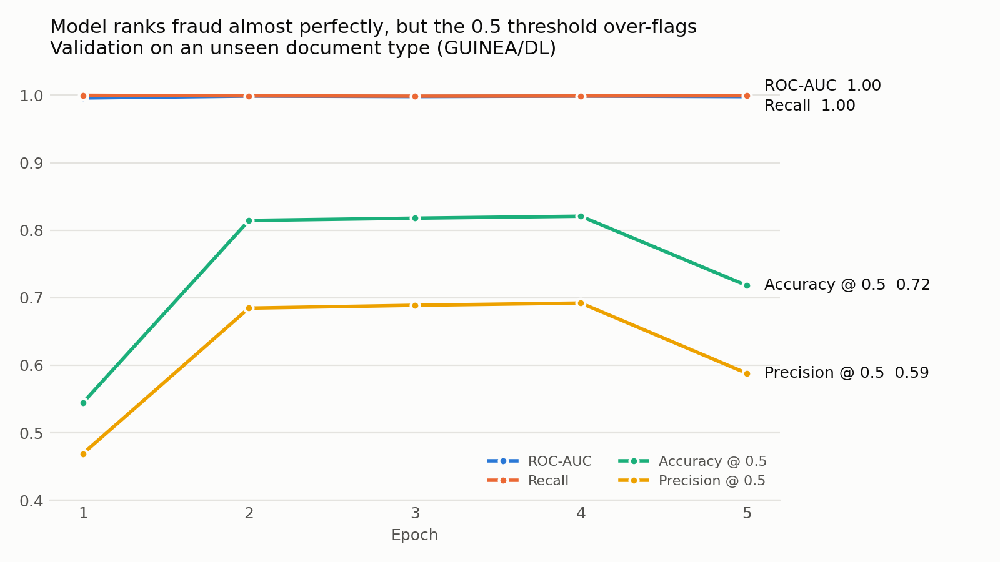

# ID Document Fraud Detection

A deep learning model that flags fraudulent identity documents (driver's licenses and national ID cards), built for the **FreUID Challenge 2026**, organized by Microblink as part of IJCAI-ECAI 2026.

The model is validated on a **document type it never saw during training**. A fraud detector in production keeps meeting new card designs, so generalising to an unseen template matters more than scoring well on a random split.



## Results

Validation on the held-out `GUINEA/DL` documents (13,389 images), best epoch:

| ROC-AUC | PR-AUC | Recall | Precision @ 0.5 | Accuracy @ 0.5 |
|---|---|---|---|---|
| **0.999** | **0.998** | **0.999** | 0.692 | 0.821 |

- **Near-perfect ranking on an unseen document type.** Almost every fraudulent card scores higher than almost every genuine one. I don't take this at face value; see the next section.
- **The default 0.5 threshold is the bottleneck.** On an unfamiliar design the scores shift upward, so about 30% of genuine documents get flagged. The ranking is right, but the cutoff isn't calibrated for a design the model hasn't seen.

### Is 0.999 too good to be true? Almost certainly.

Real-world document fraud detection doesn't look like this, and I don't expect the number to hold up outside this setup. The challenge organizers say as much: the FreUID data is built to expose weaknesses that saturated scores on purely digital data tend to hide. So the useful question isn't whether the score is inflated, but where the inflation comes from.

**Ruled out: file-level shortcuts.** Maybe the forged images were simply saved differently, at another size or JPEG quality. [`shortcut_check.py`](shortcut_check.py) trains a gradient-boosted model on file metadata only (image size, file size, bytes per pixel, JPEG quantisation tables) and tests it on each held-out document type:

| Held-out type | Metadata-only ROC-AUC |
|---|---|
| BENIN/DL | 0.500 |
| EGYPT/DL | 0.625 |
| GUINEA/DL | 0.462 |
| MAURITIUS/ID | 0.357 |
| MOZAMBIQUE/DL | 0.484 |

These scores are close to chance (0.5), so the signal isn't in the file details. It's somewhere in the pixels, which still leaves room for the wrong kind of signal.

**Still on my list:**

- **Forgery-tool fingerprints.** The fakes across all five document types were most likely made with the same editing pipeline. Holding out a card design doesn't hold out the tools, so the model may be recognising the traces they leave (blending edges, resampling noise, generator texture) instead of anything a new attacker would also leave behind.
- **Clean, digital-only images.** Only 20 of the 69,352 training images are not digital originals. Print-and-capture forgeries, which the challenge specifically targets, are printed and re-photographed, which wipes out exactly the fragile pixel traces a model like this can latch onto.
- **One possibly easy fold.** Only one document type is held out. Guinean licenses have the same image size and format as several training types, so this may be the easiest of the five splits.

I ran out of time to test these during the challenge; each one has a straightforward experiment, listed below.

## Data

- 69,352 synthetic ID document images across 5 document types: Benin, Egypt, Guinea and Mozambique driver's licenses, and Mauritius national ID cards
- Binary label: 1 = fraudulent, 0 = genuine (~42% fraudulent overall)
- The images are not included in this repository; download them from the competition page

## Approach

1. **Leave-one-document-type-out validation.** Every 1- and 2-type hold-out is scored by how close it gets to a 20% validation size and to the overall fraud rate. `GUINEA/DL` wins, giving 55,963 training and 13,389 validation images with no document type shared between them.
2. **Model.** EfficientNet-B0 pretrained on ImageNet, with a single-logit head, fine-tuned end to end.
3. **Training.** `BCEWithLogitsLoss`, Adam (lr 1e-4), batch size 64, mixed precision, 5 epochs on a single NVIDIA T4 GPU. Images are resized to 224×224 with light colour jitter.
4. **Evaluation.** Accuracy, precision, recall, F1, ROC-AUC and PR-AUC. Recall is the priority metric, since missed fraud is the costly error.

## Next steps

- [x] Sanity-check for file-level shortcuts: test whether image size or file size alone predicts the label (it doesn't, see above)
- [ ] Robustness test: re-save, blur and resize the validation images before scoring. If performance collapses, the model relies on fragile pixel traces rather than the document itself
- [ ] Grad-CAM heatmaps to see where the model looks: the photo, the text fields, or the background
- [ ] Evaluate on print-and-capture forgeries, the hard case the challenge was built around
- [ ] Full 5-fold leave-one-type-out cross-validation, reporting mean ± std instead of a single fold
- [ ] Choose the decision threshold without validation labels, or calibrate scores, instead of using a fixed 0.5
- [ ] Keep the best checkpoint, add early stopping and a learning-rate schedule
- [ ] Train at higher resolution to keep the fine detail where tampering shows up

## Repository

| File | Contents |
|---|---|
| `id_document_fraud_detection.ipynb` | Full pipeline: data, validation split, model, training, results |
| `shortcut_check.py` | Tests whether file metadata alone predicts fraud |
| `assets/validation_metrics.png` | Per-epoch validation metrics |

## Run it

The notebook needs a GPU. Download the FreUID Challenge 2026 data and set `base` in the first cell to the folder that holds `train_labels.csv` and the `train/train/` images.

The shortcut check runs locally in a few seconds, with the labels at `data/train_labels.csv` and the images in `train/`:

```bash
pip install -r requirements.txt
python shortcut_check.py
```

**Stack:** Python, PyTorch, torchvision, scikit-learn, pandas
